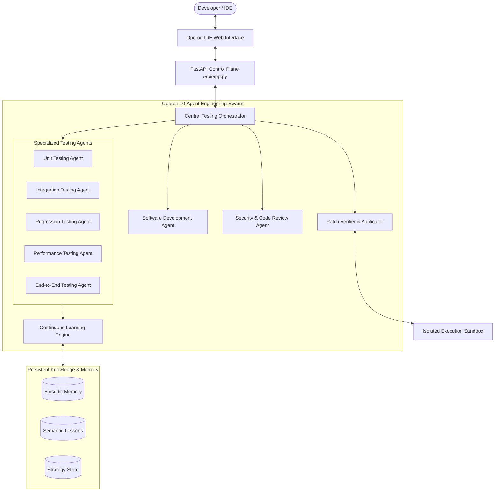

# Operon IDE — Autonomous AI Software Development Workspace


**Operon IDE** is a production-grade autonomous software engineering workspace. Named after the biological operon—a cluster of genes functioning as a single regulated unit—Operon coordinates a specialized swarm of 10 autonomous AI engineering agents to explore codebases, detect defects, generate and execute tests, propose verified patches, and continuously learn across runs.

---

## Architecture Overview



---

## Key Capabilities

### 1. High-Density Developer Workspace
- **Monaco Code Editor**: Professional dark theme (`#111318` background, `#8b83f6` accent) with multi-language syntax highlighting, tabbed navigation, dirty state tracking, and diff viewer.
- **Project Explorer**: Virtual file tree with recursive directory navigation, SVG file icons, and real filesystem synchronization.
- **Embedded Terminal**: Real-time command execution with security sandboxing, directory-scoped isolation, secret redaction, and timeout enforcement.
- **Raycast-Style Command Palette**: Fast file search and action execution via keyboard shortcut (`Ctrl+K` / `Cmd+K`).

### 2. Autonomous 10-Agent Engineering Swarm
Operon integrates 10 specialized agent roles:
1. **Unit Testing Agent**: Fast, isolated unit test generation and execution.
2. **Integration Testing Agent**: Inter-module contract and API testing.
3. **Regression Testing Agent**: Target-aware baseline preservation and historical failure reproduction.
4. **Performance Testing Agent**: Latency, memory, and throughput profiling.
5. **End-to-End Testing Agent**: User workflow and system-level validation.
6. **Software Development Agent**: Code generation, bug fixing, and refactoring.
7. **Security & Code Review Agent**: Static vulnerability analysis, AST inspection, and risk scoring.
8. **Patch Verifier Agent**: Automated patch generation, sandbox application, test re-execution, and auto-rollback on failure.
9. **Continuous Learning Engine (CLE)**: Cross-session pattern recognition, lesson distillation, and strategy evolution.
10. **Central Testing Orchestrator**: Directed acyclic graph (DAG) task scheduling, dependency resolution, and agent dispatch.

### 3. Continuous Learning Engine (CLE)
Operon learns from every task execution:
- **Episodic Memory**: Records full execution traces, tool calls, and test outputs.
- **Semantic Memory**: Distills actionable lessons (e.g., framework quirks, recurring failure modes).
- **Strategy Store**: Versioned prompt strategies evaluated against baseline benchmarks before promotion.

### 4. Verifiable Self-Repair Sandbox
- Automatically generates unified diffs for diagnosed defects.
- Applies patches in an isolated execution sandbox.
- Runs verification tests to confirm the fix before committing changes.
- Automatically reverts broken patches if regressions are detected.

---

## Getting Started

### Prerequisites
- Python 3.10+
- Modern Web Browser (Chrome, Edge, Firefox, Safari)

### Installation
```bash
# Clone the repository
git clone https://github.com/ShrihariKasar/testingagents.git
cd testingagents

# Activate virtual environment
# Windows:
.venv\Scripts\activate
# Linux/macOS:
source .venv/bin/activate

# Install dependencies
pip install -r requirements.txt
```

### Running Operon IDE
```bash
# Start the FastAPI Control Plane and Static IDE Server
python -m uvicorn backend.api.app:app --host 127.0.0.1 --port 8000 --reload
```
Open **[http://127.0.0.1:8000/](http://127.0.0.1:8000/)** in your browser.

---

## Running Verification Tests

Run the complete test suite:
```bash
pytest tests/ -v
```
All 90 integration and unit tests pass with zero failures:
```
tests/test_adapters.py .........
tests/test_agents.py ............
tests/test_continuous_learning.py ............
tests/test_orchestrator.py .........
tests/test_repair_verifier.py ..........
tests/test_workspace.py .........................
======================== 90 passed in 122.66s ========================
```

---

## Directory Structure

```
├── backend/
│   ├── adapters/          # LLM and mock model adapters
│   ├── agents/            # 10 specialized agent implementations
│   ├── api/               # FastAPI REST endpoints & WebSocket handler
│   ├── intelligence/      # Strategy evaluation and learning distillation
│   ├── memory/            # SQLite episodic, semantic, and strategy stores
│   ├── models/            # Pydantic contracts and data models
│   ├── orchestrator/      # Central swarm coordinator and task scheduler
│   ├── runners/           # Execution sandbox and subprocess isolation
│   ├── static/            # Operon IDE frontend (Monaco, CSS, JS, HTML)
│   └── workspace/         # Filesystem and terminal services
├── sample_targets/        # Sample buggy projects for self-repair verification
├── tests/                 # Comprehensive pytest suite (90 tests)
├── requirements.txt       # Dependencies
└── README.md              # Project documentation
```

---

## License
MIT License. Developed for autonomous software engineering.
